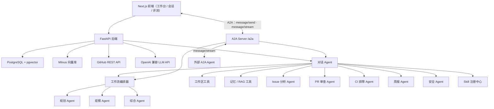

# PRism

> 本项目原名 DevFlow AI，现已统一更名为 **PRism**（历史文档与部分内部工具标识符中仍保留旧名）。

PRism 是一个面向 GitHub PR / Issue 研发协作的全栈 AI Agent 项目。系统会连接仓库数据，分析 Issue、PR diff、CI 日志、项目知识库和本地工作区代码，并返回结构化建议与安全的操作草稿。

## 核心能力

- 连接并同步 GitHub 仓库中的 Issue、Pull Request、PR 文件、Review 评论、Workflow Run、Job 和日志。
- Issue 分析：分类、优先级、复杂度、推荐负责人、重复候选和行动项。
- PR 审查：摘要、关键变更、风险点、检查清单、测试建议和需要重点关注的文件。
- CI 排障：失败类型、可能原因、排查步骤和相关上下文。
- Agent 对话：`ChatAgent` 使用原生工具调用，串联工作区、记忆、RAG、Issue、PR、CI、周报和安全工具。
- 多 Agent 工作流审查：`WorkflowOrchestrator` 构建 Planner -> 专用 Agent -> Observer -> Synthesis 的闭环，用于 PR 就绪度、阻塞项、优先级和跨领域工程决策。
- A2A 多智能体协议：后端以 `/a2a` 对外发布 Agent Card 并支持 `message/send` / `message/stream`（JSON-RPC + SSE），前端在工作台对话流里以「主控 Agent 规划 → 领域 Agent 执行 → Observer 复核 → 汇总」的协作卡呈现，并提供协议帧实时检查器。
- Skill Runtime：按用户显式指定或触发条件选择 `SKILL.md`，只向当前任务加载完整指令与受限资源；显式 Skill 校验允许工具，多 Agent 中的专用 Agent 分别加载自己的 Skill，并把版本、激活原因、指令摘要和执行校验写入 trace。
- 工作区代码工具：安全地列出文件、读取文件和搜索本地代码。
- RAG 聚焦 Issue 描述、PR 说明与 Review 评论、失败 CI 日志、项目文档、上传知识和已批准的长期记忆；当前代码走工作区/词法检索，团队与实时状态走结构化查询。
- 生成工程周报。
- 基础 Eval 覆盖 Issue 分类、PR 覆盖度、RAG 命中率、工具 schema 就绪度和结构化输出校验。

## 技术栈

- 后端：Python 3.12、FastAPI、Pydantic、SQLAlchemy、PostgreSQL + pgvector、Milvus、httpx、LangChain / LangGraph、`a2a-sdk`。
- Agent 编排：原生工具调用 + 专用分析 Agent + `WorkflowOrchestrator`（Planner → 领域 Agent → Observer → Synthesis）。
- 前端：Next.js 15（App Router）、React 19、TypeScript、Tailwind CSS（单栈，无其它前端框架）。
- 协议：A2A（Agent2Agent），JSON-RPC over HTTP + SSE 流式。
- 基础设施：Docker Compose 与 `.env` 配置。
- 部署：Nginx 反向代理 + 宝塔面板（见「部署」章节）。

## 架构



## A2A 多智能体协作

项目实现了完整的 Agent2Agent 协议链路，且前端把「多个 Agent 协作」真实地展示在对话过程中，而不是伪装成一次普通工具调用。

### 后端协议端点

开启 `A2A_ENABLED=true` 后，后端挂载 `/a2a`：

| 端点 | 说明 |
|---|---|
| `GET /a2a/.well-known/agent-card.json` | Agent Card 发现（声明 `prism_chat` 与 `prism_review` 两个 Agent） |
| `POST /a2a/` | JSON-RPC：`message/send`（一次性）、`message/stream`（SSE 流式）、`tasks/get`、`tasks/cancel` |

协议要点：请求体为 `params.message.{messageId, role, parts[]}`；流式返回 `status-update`（submitted → working）→ `artifact-update`（全文产物）→ `status-update`（`final: true`, completed），每帧携带 `taskId` / `contextId` 关联同一次任务。**调用时路径必须带尾斜杠 `/a2a/`，否则 FastAPI 会 307 重定向。**

相关配置（`.env`，默认关闭）：

```ini
A2A_ENABLED=false
A2A_PUBLIC_BASE_URL=http://127.0.0.1:8000
A2A_TRUSTED_AGENTS=            # 受信远端端点，逗号分隔
```

### 前端如何体现

1. **工作台对话流（主要体现）**：聊天输入框旁的「A2A 小组」开关打开后，一次提问会走真实的多 Agent 编排链路 —— `POST /api/chat/plan` 由主控 Agent 生成任务图，`POST /api/chat/plan/execute/stream` 让各领域 Agent 逐个执行，Observer 复核后由 Synthesis 汇总。前端以协作卡呈现：规划出的任务与负责 Agent、每位成员的真实产出与状态、Observer 置信度，以及最终汇总结论。
2. **工作台右侧「A2A」标签页（协议调试台）**：可查看本机 Agent Card、发现远端端点、手动发起 `message/send` / `message/stream`，并实时观察任务生命周期（submitted / working / completed / failed）与原始协议帧（请求、SSE 帧可展开 JSON）。

会话刷新或切换后，A2A 协作卡会依据后端持久化的 `a2a_group` 标记与 `agent_events` 重建，样式与运行中保持一致。

代码位置：`backend/app/a2a/`（协议服务）、`frontend/lib/a2a.ts`（协议客户端与帧解析）、`frontend/components/chat/a2a-discussion.tsx`（对话流协作卡）、`frontend/components/workspace/a2a-panel.tsx`（协议调试台）。

## 快速开始

```bash
cp .env.example .env
docker compose up -d postgres etcd minio milvus

cd backend
python -m venv .venv
.venv\Scripts\activate
pip install -r requirements.txt
uvicorn app.main:app --reload
```

另开一个终端：

```bash
cd frontend
npm install
npm run dev
```

默认地址：

- 后端：http://localhost:8000
- API 文档：http://localhost:8000/docs
- 前端：http://localhost:3000

## RAG 知识问答系统

项目内置了与第 7.1 节流程一一对应的完整 RAG 系统：知识库创建向导、文档解析、段落感知切片、Embedding、向量/关键词混合检索、重排、召回测试、问答工作室、上下文组装、基于证据生成和编号引用。支持 TXT、Markdown、PDF、DOCX、JSON、CSV 与日志文件；重复文件会按 SHA-256 跳过。

对话链路采用混合 RAG：`ContextAssembler` 会在调用 ChatAgent 前按原始问题检索并注入证据；进入推理循环后，模型仍可把 `rag.search_similar_documents` 当作工具，改写查询、连续补查不同资料，并根据多次工具结果交叉验证答案。

项目不会把所有私域数据都向量化。只有需要跨来源语义召回、会反复使用的非结构化知识进入 RAG；源码与配置以当前 checkout 为准，优先通过 `workspace.search_code` 和 `workspace.read_file` 检索；Issue、PR、CI 的状态字段、团队成员和周报等结构化或派生数据直接查数据库/API。RAG 返回的是候选证据，涉及实时状态和当前代码时仍要回到权威数据源核验。

从旧版本升级后，请对每个知识库调用一次 `POST /api/rag/{repo_id}/reindex`。重建会按新边界清理历史向量和旧会话 Document；只部署代码不会主动删除已有索引。

如果只想先验证页面、结构化数据和无模型兜底回答，Windows 本地可以用下面的脚本启动 SQLite 演示环境：

```powershell
.\scripts\start_rag.ps1
```

脚本会关闭 Milvus，使用 deterministic embedding 和启发式重排，并停用演示知识库的 `0.8` 分数阈值，避免只有关键词分支时全部候选都被过滤。因此它可以验证页面、上传解析、关系库存储、Hybrid 的关键词分支和引用展示，但向量检索状态会明确显示 `degraded`，不能用来证明完整 RAG 已经跑通。要验证向量召回、混合检索和重建索引，仍需先按“快速开始”启动 PostgreSQL、etcd、MinIO 和 Milvus。

知识库默认选择 `Qwen/Qwen3-Embedding-0.6B` 与 `qwen3-rerank`：配置 `DASHSCOPE_API_KEY`、`RERANK_BASE_URL` 后走百炼 `text-embedding-v4` 与 `qwen3-rerank`；如需本地运行 Qwen Embedding，需自行安装 `sentence-transformers` 与 `transformers`（代码里为懒加载，缺失只影响本地向量模型，不影响服务启动）。默认 Embedding 依赖缺失时系统会明确报错，不会在生产配置下静默改用另一套向量空间；只有上面的本地演示脚本会显式选择 deterministic embedding。已经配置 `LLM_API_KEY` 时，可用 `.\scripts\start_rag.ps1 -UseConfiguredLLM` 启用模型生成。

RAG API：

```text
POST /api/rag/knowledge-bases
GET  /api/rag/knowledge-bases
GET  /api/rag/knowledge-bases/{repo_id}
POST /api/rag/knowledge-bases/{repo_id}/documents
POST /api/rag/knowledge-bases/{repo_id}/retrieval-tests
GET  /api/rag/{repo_id}/status
POST /api/rag/{repo_id}/search
POST /api/rag/{repo_id}/ask
POST /api/rag/{repo_id}/reindex
```

## ChatAgent RAGAS 评测

启动主应用后打开 `http://127.0.0.1:3000/evals`，选择仓库、固定评测集和 Top-K，再点击“运行固定 RAGAS 评测”。评测会在隔离会话中真实运行生产 ChatAgent 和工具集，收集预检索与 Agent 二次检索证据，然后使用 Ragas 0.4 Collections API 计算 Context Precision、Context Recall、Faithfulness、Answer Relevancy 和 Agent Goal Accuracy。结果会保存评测集 Hash、阈值、逐题工具轨迹、检索证据、硬规则与失败诊断，便于对同一基线做回归。

默认 Judge 复用 `LLM_API_KEY`、`LLM_BASE_URL` 和 `LLM_MODEL`；也可以通过 `.env` 中的 `RAGAS_JUDGE_API_KEY`、`RAGAS_JUDGE_BASE_URL`、`RAGAS_JUDGE_MODEL` 单独配置。主项目内置的正式基准位于 `docs/datas/evals/rag_cases.json`，启动时会检查用例引用的文档是否已进入当前仓库知识库：

```http
POST /api/evals/rag/run
Content-Type: application/json

{
  "repo_id": "<repository-uuid>",
  "run_judge": true,
  "top_k": 5,
  "suite_id": "prism-real-project-rag-baseline"
}
```

提交接口会立即返回 `queued` 状态和 `eval_id`，ChatAgent 与 RAGAS 在后台继续运行。通过 `GET /api/evals/{eval_id}` 轮询 `result.progress`；状态变为 `passed`、`failed`、`error` 或 `no_cases` 时结束。网页会自动轮询，刷新或离开页面不会中断已经提交的任务。

整体通过要求硬规则全部满足，并且五项语义指标都达到 `.env` 中对应的 `RAGAS_*_MIN` 门槛。页面把“执行状态”和“质量状态”分开显示：低分是质量失败；Judge 调用失败或指标缺失是评测不完整，不能伪装成质量结论。

评测失败后可以直接在同一页面继续处理：

- 展开 Case 查看实际回答、参考答案、检索来源、工具轨迹和可执行诊断；
- 对 Judge 超时或缺失指标点击“仅重试异常评分”，复用已经保存的回答和证据，不重新运行 ChatAgent；
- 选择两个相同评测集 Hash、Ragas/Judge 配置和 Top-K 的结果做回归对比；
- 生成 `create_issue` 类型的 ActionDraft，把失败 Case、证据和建议带入人工确认流程，不会直接写入 GitHub。

## 部署（宝塔面板）

运行时由三部分组成：Next.js 前端（`127.0.0.1:3000`）、FastAPI 后端（`127.0.0.1:8000`）、PostgreSQL + pgvector。Milvus 可选，内存不足时设置 `MILVUS_ENABLED=false` 走数据库回退路径。

1. **环境**：宝塔安装 Nginx、PostgreSQL 管理器、Python 项目管理器（3.12）、Node.js 版本管理器（20 LTS）、PM2 管理器。
2. **数据库**：`docker compose up -d postgres`（镜像已带 pgvector），或使用面板 PostgreSQL 并安装 pgvector 扩展。
3. **后端**：
   ```bash
   cd /www/wwwroot/prism/backend
   python3.12 -m venv venv && ./venv/bin/pip install -r requirements.txt
   cp ../.env.example ../.env    # 修改生产配置
   uvicorn app.main:app --host 127.0.0.1 --port 8000
   ```
   生产 `.env` 必须修改：`APP_ENV=production`、`DEMO_MODE=false`、`TOKEN_ENCRYPTION_KEY`、`ADMIN_PASSWORD`、`DATABASE_URL`、`LLM_API_KEY`、`CORS_ORIGINS`（填前端域名）。
4. **前端**：
   ```bash
   cd /www/wwwroot/prism/frontend
   echo "NEXT_PUBLIC_API_BASE_URL=https://你的域名" > .env.production
   npm ci && npm run build
   pm2 start npm --name prism-web -- start -- -p 3000
   ```
   注意：`NEXT_PUBLIC_API_BASE_URL` 是**构建期**注入的，修改后必须重新 `npm run build`，仅重启无效。
5. **Nginx**：单域名即可，`/` 反代 3000，`/api/` 与 `/a2a/` 反代 8000；SSE 需要 `proxy_buffering off; proxy_read_timeout 600s; proxy_http_version 1.1;`，`/a2a/` 的 `proxy_pass` 需保留尾斜杠。SSL 用面板一键申请。
6. **收尾**：8000/3000 只绑 `127.0.0.1`，防火墙仅放行 80/443；确认 `backend/.data/` 对运行用户可写；为 PostgreSQL 与 `.data/` 配置定时备份。


