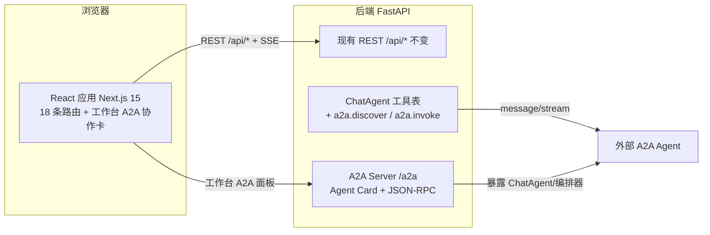

# PRism 重构方案：React 单栈 + A2A 多智能体协议

> 状态：Phase 0/1/2 已完成（A2A 落在工作台内嵌展示），Phase 3 联调回归进行中
> 目标读者：项目所有者
> 关联决策：前端收敛为 React 单栈（Next.js 15）；后端增量接入 A2A 协议；A2A 效果不单独开页面，直接在工作台对话流体现

---

## 一、目标与原则

| 目标 | 说明 |
|---|---|
| React 单栈 | 前端只维护一套 Next.js 15 + Tailwind 实现，18 条路由持续演进 |
| A2A 纯增量 | 后端以新增模块方式接入 Agent2Agent 协议，不删改任何现有路由/Agent/RAG/评测逻辑 |
| 可回退 | 每阶段独立可验收，任一阶段失败不影响已上线能力 |
| 面试叙事 | React 单栈工程化 + A2A 多智能体协议 = 差异化考点 |

**明确不删除清单**（承诺不动）：
- 18 组 REST 路由、LangGraph 工具循环、Milvus RAG 管线、RAGAS 评测、Skill Runtime、MCP 记忆
- 32 张数据库表、docker-compose 结构（本地原生 PG 运行方式不变）
- React 版全部页面功能与 API 契约（`NEXT_PUBLIC_API_BASE_URL` 继续生效）

---

## 二、目标架构



- **React 前端**：现有 Next.js 应用，18 条路由不变，`tsc --noEmit` 与 `next build` 双绿
- **A2A**：后端新增 `/a2a` 挂载点 + ChatAgent 两个新工具，对外可被任意 A2A 端点发现与调用
- **远端 Agent**：本机 Agent 通过 Agent Card 对外发布，同时可发现并调用外部 A2A 端点

---

## 三、阶段划分

### Phase 0 — PRism 统一更名（已完成）

| 项 | 现值 | 改为 |
|---|---|---|
| `APP_NAME` (.env) | DevFlow AI | PRism |
| `layout.tsx` metadata | 已改 ✓ | — |
| `app-shell.tsx` 品牌区 | 已改 ✓ | — |
| package.json name | devflow-ai-frontend | prism-frontend |
| Milvus collection / prompt cache key | devflow_* | prism_* |
| README 标题 | DevFlow AI | PRism（附更名说明） |
| 数据库（可选，由你自行执行） | prism | 如需改名：`ALTER DATABASE prism RENAME TO 新名;` + `.env` 同步 |

**验收**：全局搜索 `devflow`/`DevFlow` 仅剩历史注释；`tsc --noEmit` 通过。

### Phase 1 — A2A 后端（已完成）

`backend/app/a2a/` 六件套：

```
app/a2a/
├── card.py          # Agent Card 构建（ChatAgent、WorkflowOrchestrator 两个 skill）
├── server.py        # A2AStarletteApplication 挂载 /a2a（FastAPI 原生兼容）
├── skills.py        # 把 chat_agent.run / orchestrator 包装成 A2A AgentSkill
├── sse_adapter.py   # run_stream 事件(delta/tool_use/final) → TaskStatusUpdateEvent/Artifact
├── client.py        # A2A 客户端：发现远端 Agent Card、发起 message/send|stream
└── tools.py         # 注册 a2a.discover_agents / a2a.invoke_agent 两个工具进 ChatAgent
```

协议映射要点：
- Agent Card 发布于 `/.well-known/agent-card.json`（a2a-sdk 锁 `>=0.3,<0.4`，按对应 spec 命名）
- `message/send` / `message/stream` JSON-RPC + SSE ↔ 现有 `run_stream`：Task id/context id 关联，final 时产出 Artifact（复用 AnalysisResult + citations）
- WorkflowOrchestrator：任务 spec 新增可选 `executor: a2a://<agent-url>` 分支，Observer/Synthesis 不动
- ChatAgent 新增工具 `a2a.discover_agents` / `a2a.invoke_agent`
- `.env` 三行（默认关闭）：`A2A_ENABLED=false`、`A2A_PUBLIC_BASE_URL`、`A2A_TRUSTED_AGENTS`

**验收（已达成）**：`A2A_ENABLED=true` 后 `curl /a2a/.well-known/agent-card.json` 返回合法卡片（HTTP 200）；全量 `pytest` 209 通过；关掉开关后系统行为与现状完全一致。

### Phase 2 — React 工作台内嵌 A2A（已完成）

A2A 不单独开页面，直接落在已有的工作台（`frontend/app/page.tsx`），分两处体现：

1. **对话流协作卡**（主要形态）
   - 输入框旁「A2A 小组」开关：开启后提问走 `POST /api/chat/plan`（主控 Agent 生成任务图）→ `POST /api/chat/plan/execute/stream`（领域 Agent 逐个执行）→ Observer 复核 → Synthesis 汇总
   - 协作卡逐条展示：规划出的任务与负责 Agent、每位成员的真实产出与状态、Observer 置信度、最终汇总结论
   - 后端把 `a2a_group` 标记与 `agent_events` 持久化到消息 meta，刷新或切换会话后按历史重建同一张卡片
2. **工作台右侧「A2A」标签页（协议调试台）**
   - 本机 Agent Card 展示 + 远端端点发现（`A2A_TRUSTED_AGENTS` 预置 + 页面内可编辑）
   - `message/send` 与 `message/stream` 双通道任务提交，可中断
   - 任务生命周期时间线（submitted / working / completed / failed）+ `taskId` / `contextId` 关联
   - SSE 原始协议帧实时检查器（请求帧、响应帧、可展开 JSON）

代码落点：`frontend/lib/a2a.ts`（协议客户端与帧解析）、`frontend/components/chat/a2a-discussion.tsx`（协作卡）、`frontend/components/workspace/a2a-panel.tsx`（调试台）。

**验收（已达成）**：工作台「A2A 小组」提问后可见多 Agent 协作卡与真实 Agent 产出；右侧 A2A tab 可拉取 Agent Card 并跑通 `message/stream`；`tsc --noEmit` 与 `next build` 双绿。

### Phase 3 — 联调与回归（进行中）

- 工作台 A2A 链路对本机 `/a2a` 联调（协作卡、`message/send`/`message/stream`、时间线、协议帧）
- ChatAgent 工具验证：对话中让 Agent「调用远端 Agent 分析 X」，观察 a2a.invoke_agent 轨迹
- RAGAS 回归：跑一轮固定评测确认 Agent 行为无破坏

**验收**：pytest 209 保持通过；`tsc --noEmit` + `next build` 双绿。

---

## 四、风险与对策

| 风险 | 对策 |
|---|---|
| a2a-sdk 版本变动快 | 锁定 `>=0.3,<0.4`，card.py 集中隔离 spec 命名差异 |
| run_stream → A2A 事件语义差异 | sse_adapter 单文件适配器 + 单测覆盖三类事件 |
| CORS | 后端白名单核对前端 dev 源，联调 `/a2a` 时验证 Origin 放行 |
| 远端 Agent 不可达 | 客户端超时与页面降级提示；`A2A_ENABLED=false` 时整体关闭，行为回退现状 |

## 五、里程碑顺序与交付物

```
Phase 0 更名 ✓ → Phase 1 A2A 后端 ✓ → Phase 2 工作台内嵌 A2A ✓ → Phase 3 联调与回归
```

每阶段交付：代码 + 对应验收命令输出 + README 增量更新。

---

## 六、审批点

1. 工作台内嵌形态（对话流协作卡 + 右侧 A2A 调试台）是否认可？
2. 远端 Agent 端点配置方式（`.env` 的 `A2A_TRUSTED_AGENTS` + 页面内可编辑列表）是否认可？
3. Phase 3 联调与回归的顺序是否认可？
4. 数据库改名是否随 Phase 0 一起做（由你自己执行 ALTER DATABASE）？

> 确认后按 Phase 2 → 3 顺序推进；每阶段完成即汇报，随时可叫停。
